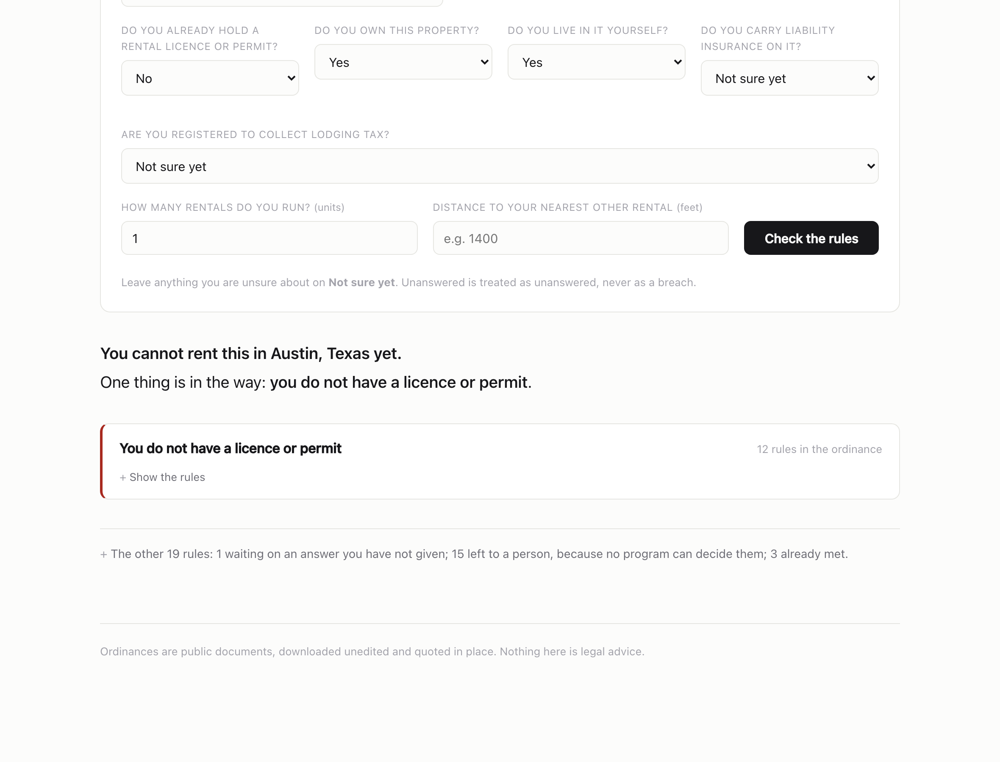

# rulecheck

Five US cities regulate short-term rentals. All five require a licence, three
require the owner to live there, two require insurance, and every one of them
writes it differently. This reads all five ordinances and puts them in one table.


A model reads each ordinance once. Everything after that is ordinary code.

## The idea

The hard part of this problem is not the language. It is that the same
obligation shows up as *operator's license* in Austin, *permit* in New Orleans,
and *short-term residential occupancy licence* in San Diego, and no amount of
string matching will tell you those are the same thing.

So there are two passes, and they are kept apart on purpose:

**Extraction** reads one ordinance and returns a list of requirements, each one
carrying the sentence it came from. The model is handed a schema it is required
to fill, so the category field cannot take a value outside the enumerated list
and no requirement can be recorded without its source text.

**Matching** takes those requirements and assigns each to one of seventeen
shared identifiers. This is the canonical model, and it is deliberately fixed.
A requirement that genuinely does not fit is marked unmapped and shown
separately rather than forced into the nearest box — thirty of the hundred and
thirty-three currently sit there, which is information, not a gap.

Keeping the passes separate matters because they fail differently. Extraction
gets the ordinance wrong; matching gets the comparison wrong. Run them as one
step and a bad row in the table could be either.


## Where the model is, and where it is not

| Step | Model | Why |
|---|---|---|
| Download and clean the ordinance | no | Stripping page headers is not a judgement call |
| Extract requirements | **yes** | Reading law requires reading |
| Assign a shared identifier | **yes** | Deciding two sentences mean the same thing requires judgement |
| Build the comparison | no | Grouping labelled records is a `for` loop |
| Check a property | no | "Does this licence exist" is a comparison, not an inference |

Putting a model in the last row would make the tool slower, more expensive, and
impossible to test.

## Silence is not a no



Each rule resolves to satisfied, violated or unknown, and the third one is the
reason the project exists. Submitting the form with nothing filled in returns
zero violations, not thirty, because nobody has said anything yet.

Unknown is also split in two, which matters more than it sounds. One kind you
can clear by answering a question. The other no answer will ever settle: whether
noise carries past the property line, whether the place is habitable, whether a
local contact really turns up within two hours. Those are judgements, so they
are handed to a person rather than guessed at.

Austin states the licence requirement in twelve separate places, so a property
without one fails twelve rules. The page says *you do not have a licence* once,
and keeps the twelve behind a toggle for anyone who wants them.

## Running it

```bash
docker compose up          # http://localhost:8000
```

Or without Docker:

```bash
uv sync
uv run rulecheck serve
```

Rebuilding the data needs an Anthropic API key in `.env`:

```bash
uv run rulecheck fetch              # download all five ordinances
uv run rulecheck extract            # ordinance text  -> rules
uv run rulecheck match              # rules -> shared identifiers
uv run rulecheck compare            # print the table
uv run rulecheck check --rules data/austin.rules.json \
                       --property examples/austin-house.json
```

`fetch` is reproducible: the source URL for each city lives in `sources.py`, so
the corpus can be rebuilt from nothing rather than trusting whatever text file
happens to be checked in.

## Measuring it

An extraction that looks right and is wrong is worse than one that fails loudly,
so there is a number rather than an impression.

Someone reads three sections of the Austin ordinance by hand and writes down
every obligation it places on an owner. That list is the key. The extraction is
then scored against it:

```
section      expected  found  missed  unsupported
4-23-32             5      5       0            1
4-23-33             4      4       0            0
4-23-34            10      8       2            0

recall    17/19 = 89%
precision 17/18 = 94%
```

```bash
uv run rulecheck evaluate --city austin --verbose
```

Both numbers matter and they pull against each other. A missed requirement is a
rule somebody breaks without knowing. An unsupported one sends somebody chasing
a duty that does not exist.

**The one it invented.** The ordinance says a licence *is valid for a maximum of
two years*. The model recorded *the owner must renew at least every two years*.
That is a reasonable inference and it is not what the text says, which is
precisely what the prompt forbids. The real renewal duty lives two sections
away, so the output is right by accident and wrong by method.

**The two it missed.** One section lists three duties under one lead-in —
obey the law, make sure guests obey it, apply mitigation measures where they
apply. The model read that as a single requirement. Whether it is one or three
is a judgement, and the key takes a side, which is what a key is for.

### What the number does not cover

The key was written against three of the twenty-two sections, so this is a
sample, not a grade. Pairing the two lists is done by a model as well, which
puts a model inside the measurement of a model — every pairing is printed with
`--verbose` so it can be checked, but that is mitigation rather than a fix.

The table on the comparison page has errors of its own that this does not
touch: `LICENSE_REQUIRED` shows *12 months* for Austin because a rule carrying a
number landed in the wrong row during matching. Extraction and matching need
separate keys; only extraction has one so far.

## Stack

Python 3.13, uv, Pydantic for the schemas, FastAPI for the interface, pytest and
ruff. The Anthropic API with strict tool use.

Ordinances are public documents, downloaded unedited and quoted in place.
Nothing here is legal advice.
